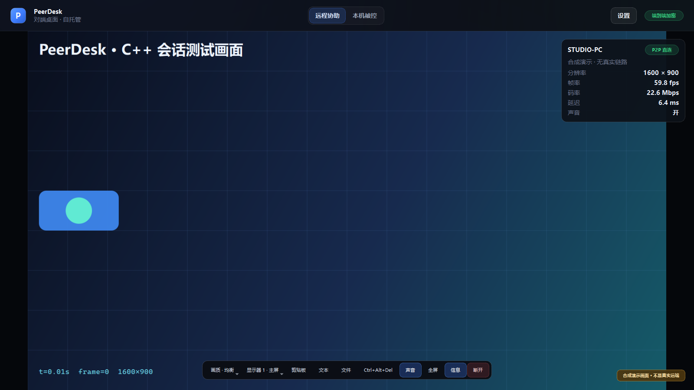

# PeerDesk · 对端桌面

**自托管的 Windows 远程桌面：原生 Qt 6 客户端、C++20 后端、9 位连接码、UDP 直连优先、自建中继兜底。**

PeerDesk 以逆向分析得到的 UU远程 交互为参照，持续补齐连接、会话和桌面操作体验。
它不是 UU远程 的等价替代品，也不包含对方的代码、资源或凭据。

[](https://github.com/Bad0RANG3/peerdesk/actions/workflows/ci.yml)




> 上图由 `--page viewer --viewer-demo` 生成。画面来自合成信号源，不读取真实桌面；
> HUD 中的 `1600×900 / 59.8 fps / 22.6 Mbps / 6.4 ms` 是固定演示值，**不是实测性能**。

## 当前状态

版本 **0.7.0**，处于原生迁移与产品化之间。服务端、传输、会话、Windows 平台层和
Qt 应用壳均已切换到同一套 C++ 实现，主连接路径可用；真实跨机、弱网和长时间会话
仍需单独验收。Viewer 在同一连接码下的断线恢复已经接入并通过回环测试；
安装器、自动更新和开机自启尚未完成。旧 Python 实现、Web 前端、PyInstaller 打包和
pytest 资产已经从仓库移除，构建、测试与 CI 只依赖原生工具链。

## 体验目标

- 像 UU远程 一样用 9 位码快速连接，不要求账号，不把中继能力做成会员项。
- 原生窗口承载连接页、被控端页和会话页，避免多开终端或跳转外部界面。
- 连接后直接进入桌面画面；悬浮工具栏、HUD、画质、显示器、声音、文件与全屏操作都在会话内完成。
- 短暂断线时不退回连接页，保留最后一帧并自动尝试恢复原会话。
- 打洞成功时走直连，网络不允许时自动升级到自托管 UDP 中继。

## 已实现

- **原生客户端**：Qt 6 Widgets 连接页、被控端面板、Viewer、设置对话框、系统托盘和窗口状态记忆。
- **纯原生仓库**：服务端、客户端、测试和发布入口统一由 CMake/C++20/Qt 构建，不依赖
  Python、Node.js 或旧 Web 服务。
- **连接与信令**：9 位连接码、3-3-3 显示、直连优先、6 秒升级中继、服务器令牌、连接频次限制。
- **加密传输**：X25519 临时密钥、HKDF-SHA256、每数据包 AEAD、重放窗口和中继密文转发。
- **视频**：GDI 抓屏、多显示器、JPEG 质量自适应、静帧跳过、XOR FEC、缺片 NACK、关键帧请求。
- **声音**：WASAPI loopback、16 kHz 单声道、20 ms G.711 µ-law 帧、上一帧冗余和静音抑制。
- **桌面控制**：绝对坐标键鼠、滚轮、文本/IME、剪贴板文本、`Ctrl+Alt+Del`、相对移动接口和按键释放。
- **文件**：双向传输、24 KiB 分块、进度/错误提示、发送中取消、断链中断提示、单文件
  512 MiB 上限和落盘前路径校验。
- **会话交互**：五档画质、显示器切换、声音开关、全屏、160 ms 淡入淡出并自动隐藏的
  悬浮工具栏、实时 HUD、拖放上传和取消发送。
- **断线恢复**：Viewer 实况中断后保留最后一帧和连接上下文，隔离旧输入，并在 30 秒内
  按同一连接码重新配对、重新握手和请求关键帧。
- **自托管服务端**：TCP 信令、UDP 中继和 STUN 共用一套服务；每会话中继限速，超限丢包。

五档画质分别为：`流畅`、`均衡`、`高清`、`超清`、`原画`。

## 架构

```text
被控端 peerdesk-client ──TCP 信令──▶ peerdesk-server ◀──TCP 信令── 控制端 peerdesk-client
                         └──── PDTP/1 over UDP：直连或 RLY1 中继 ────┘
STUN 与中继共用服务端 UDP 端口
```

| 路径 | 职责 |
| --- | --- |
| `src/core/` | 报文、分片、FEC、可靠流、STUN、X25519/HKDF/AEAD、重放窗口 |
| `src/transport/` | `PeerLink` 握手、候选、打洞、中继、保活、统计 |
| `src/server/` | TCP 信令、连接码注册、UDP 中继、STUN、令牌与限速 |
| `src/client/` | TCP JSON Lines 信令客户端 |
| `src/session/` | 被控端/控制端会话、音视频、输入、剪贴板、文件 |
| `src/app/` | 控制器、偏好、画质预设、声音播放 |
| `src/ui/` | 原生窗口、连接页、被控端面板、Viewer、设置和主题 |
| `src/platform/` | GDI 抓屏、WASAPI、Win32 输入和剪贴板 |

协议细节见 [PDTP/1 协议规范](docs/03-protocol-pdtp1.md)，模块与数据流见
[架构说明](docs/02-architecture.md)。

## 构建

要求：

- Windows 10/11 x64
- CMake 3.24+
- Ninja
- Qt 6.8.3 `mingw_64`
- MinGW 13.1（Qt 安装器自带）

```powershell
git clone https://github.com/Bad0RANG3/peerdesk.git
cd peerdesk
$env:PATH = "C:\Qt\6.8.3\mingw_64\bin;C:\Qt\Tools\mingw1310_64\bin;$env:PATH"
cmake --preset windows-mingw
cmake --build --preset windows-mingw
```

产物位于 `build/cpp/`：

- `peerdesk-server.exe`
- `peerdesk-client.exe`
- `peerdesk-link-harness.exe`

## 测试

```powershell
ctest --preset windows-mingw --output-on-failure
```

当前有 11 个 CTest 套件：`peerdesk-core`、`peerdesk-crypto`、`peerdesk-transport`、
`peerdesk-stun`、`peerdesk-server`、`peerdesk-peer-link`、`peerdesk-session`、
`peerdesk-signaling-client`、`peerdesk-app-controller`、`peerdesk-ui`、`peerdesk-platform`。
CI 在 Windows 上配置、编译并执行全部套件。

## 运行

### 1. 启动服务端

```powershell
.\build\cpp\peerdesk-server.exe --port 7900 --udp-port 7901
```

跨机部署时需要放行 TCP `7900` 和 UDP `7901`。建议为公开服务器设置令牌与中继带宽：

```powershell
.\build\cpp\peerdesk-server.exe --port 7900 --udp-port 7901 `
  --token "<shared-token>" --relay-mbps 50 --connect-max 10 --connect-window 60
```

### 2. 启动被控端

```powershell
.\build\cpp\peerdesk-client.exe --page host `
  --server 127.0.0.1:7900 --code 604173829 --token "<shared-token>"
```

在被控端面板确认连接码、服务器、令牌、键鼠/剪贴板权限和接收目录，然后开始被控。

### 3. 启动控制端

```powershell
.\build\cpp\peerdesk-client.exe --server 127.0.0.1:7900 --token "<shared-token>"
```

在连接页输入相同的 9 位码。连接成功后自动进入会话页。

### 安全预览会话页

```powershell
.\build\cpp\peerdesk-client.exe --page viewer --viewer-demo
```

该模式只渲染合成画面，不读取屏幕、不注入输入、不联网传输。

## 服务端参数

| 参数 | 默认值 | 说明 |
| --- | --- | --- |
| `--host` | `0.0.0.0` | TCP/UDP 监听地址 |
| `--port` | `7900` | TCP 信令端口，`0` 为随机 |
| `--udp-port` | `7901` | UDP 中继与 STUN 端口，`0` 为随机 |
| `--token` | 空 | 客户端共享令牌；设置后两端必须一致 |
| `--relay-mbps` | `0` | 每会话中继上限，`0` 表示不限 |
| `--connect-max` | `10` | 每个 IP 在窗口内的连接尝试上限 |
| `--connect-window` | `60` | 连接尝试计数窗口，单位秒 |
| `-v`, `--verbose` | 关闭 | 输出调试日志 |
| `--version` | — | 输出版本后退出 |

环境中可设置 `PEERDESK_BIND`、`PEERDESK_PORT`、`PEERDESK_UDP_PORT`、
`PEERDESK_TOKEN` 和 `PEERDESK_RELAY_MBPS` 作为对应默认值。

## 客户端参数

| 参数 | 说明 |
| --- | --- |
| `--server HOST:PORT` | 信令服务器，默认取已保存偏好或 `127.0.0.1:7900` |
| `--token TOKEN` | 服务器令牌 |
| `--code CODE` | 本机被控连接码或预填连接码 |
| `--page remote\|host\|viewer\|settings` | 启动页面，默认 `remote` |
| `--viewer-demo` | 合成 Viewer，仅能配合 `--page viewer` |
| `--capture native\|test` | 使用真实 GDI 抓屏或合成信号源 |
| `--audio-test` | 使用 440 Hz 合成音源 |
| `--screenshot PATH` | 保存窗口截图后退出 |
| `--exit-after MS` | 指定毫秒后自动退出 |

`--capture test`、`--audio-test`、`--viewer-demo` 或截图模式会使用临时偏好，
不会覆盖日常配置。

## 安全边界

- 9 位连接码是会话预共享密钥的一部分。知道连接码且网络可达的人可以发起配对。
- 服务端保存连接码摘要，不保存用于派生的明文码；中继只转发加密后的 PDTP 数据报。
- 服务端仍能看到连接元数据、候选地址、流量大小和时序，也能丢包或阻断会话。
- `--token` 只保护信令入口，不能替代传输加密。内置信令是明文 TCP，公网部署应放在
  TLS 终结代理或可信内网之后。
- 中继限速默认按单会话令牌桶执行；超过 `--relay-mbps` 的数据报会被丢弃。
- 被控端必须在可信网络中运行，并谨慎开放键鼠、剪贴板和文件接收权限。

## 已知限制

- **断线恢复仍需跨机验收**：回环测试已覆盖同码重配对、保帧、输入隔离、恢复超时和挂断静默；
  真实 NAT、信令长时间中断、进程重启以及文件/媒体断点续传尚未形成正式验收结论。
- **可靠补洞仍需真实网络验收**：回环测试已覆盖乱序补洞、重复包、窗口越界、非法 ACK、
  重传上限和重置；真实丢包网络与长时间序号回绕尚未形成正式验收结论。
- 真实跨机、NAT 组合、丢包、抖动和长时间会话尚未形成正式验收报告。
- 视频仍是整帧 JPEG，未使用帧间编码或硬件编码，弱网下码率明显高于 H.264 方案。
- 抓屏仅有 GDI 路径，每帧完整抓取/缩放/编码；没有脏矩形、GPU 纹理或增量编码。
- 声音仍是 G.711 µ-law，适合语音，不适合音乐；还没有 Opus 双栈。
- 输入使用 Win32 `SendInput`；没有虚拟 HID，个别游戏或受保护界面无法注入。
- 分辨率受真实桌面限制；没有虚拟显示器驱动。
- 剪贴板只同步文本，图片和文件列表尚未纳入剪贴板通道。
- 没有安装器、自动更新、开机自启和代码签名。
- 与 UU远程 的交互仍有差距：相对鼠标/游戏模式、多文件队列与断点续传和弱网策略
  尚待补齐。

## 路线图

1. 两台真实 Windows 主机完成直连、中继、弱网、多屏、文件、长会话与断线恢复验收。
2. 补齐安装器、可关闭的开机自启、日志归档和更新机制。
3. 引入 H.264 与 Opus，并在不可用时回退到 JPEG / G.711。
4. 评估虚拟显示器、虚拟 HID、相对鼠标和游戏模式。
5. 继续扩展真实跨机验收、媒体质量和输入兼容性；旧技术栈清理已经完成。

更细的优先级见 [路线图](docs/05-roadmap.md)。

## 文档

- [逆向分析：网易UU远程](docs/01-reverse-engineering.md)
- [架构与数据流](docs/02-architecture.md)
- [PDTP/1 协议规范](docs/03-protocol-pdtp1.md)
- [UI 与交互对齐](docs/04-ui-parity.md)
- [路线图](docs/05-roadmap.md)
- [交接手册](docs/06-handover.md)

## 许可

Apache-2.0。仅用于自有设备之间的远程访问与协议研究。网易UU远程及其他产品名称、
商标和资源归各自所有者。
