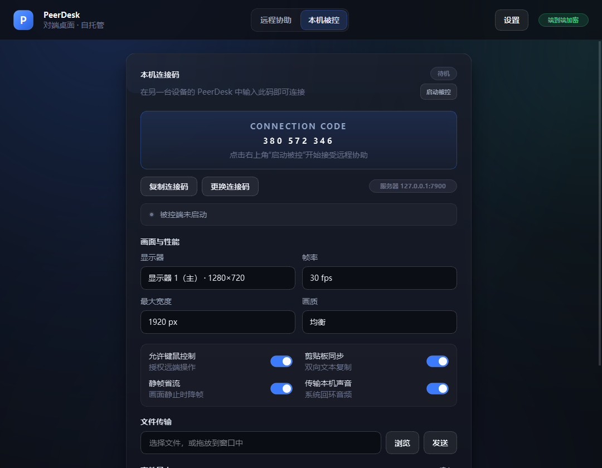
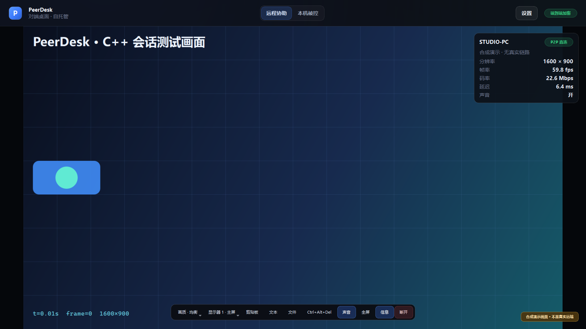
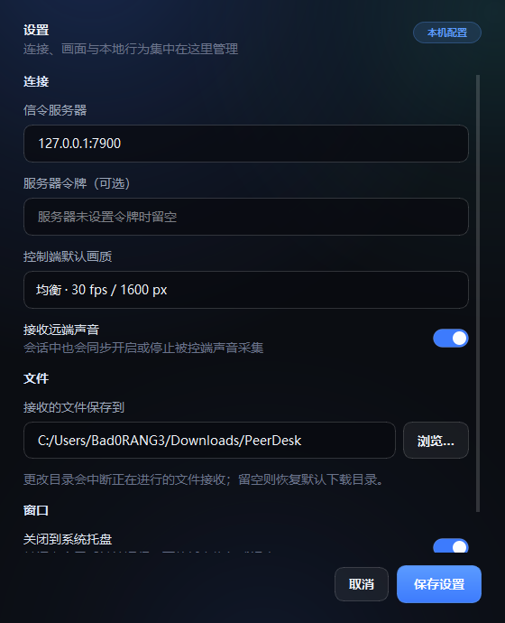
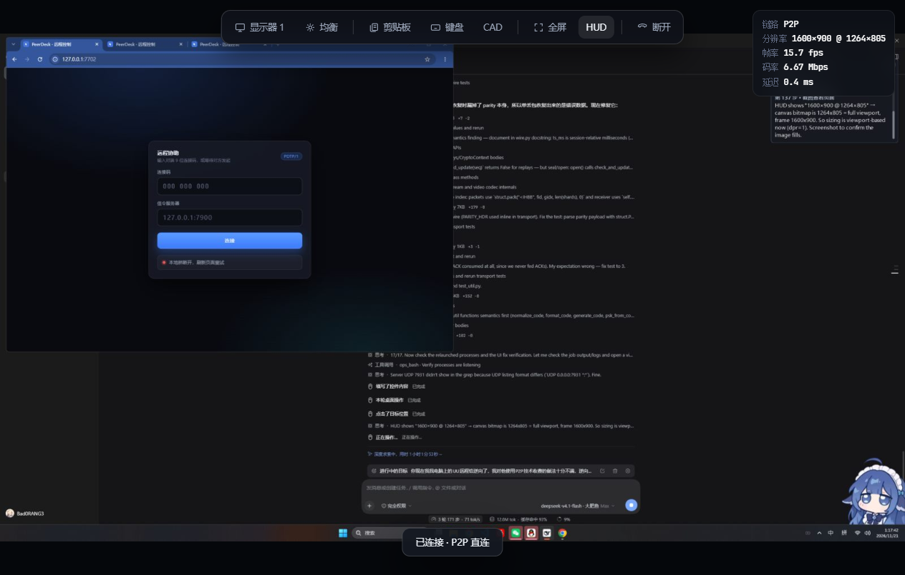
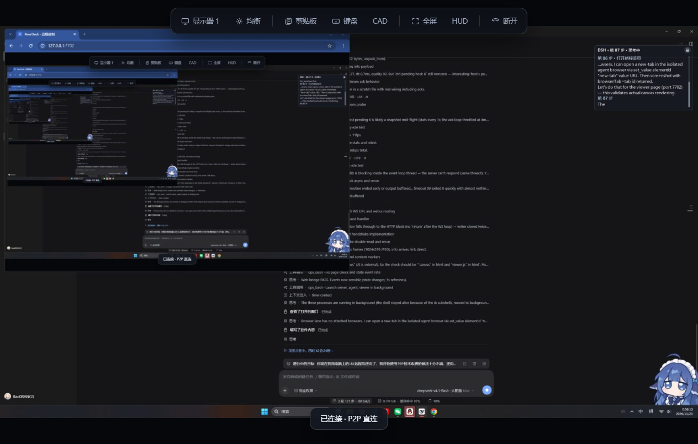

# UI 复刻对照

目标不是像素级抄一份，而是把 **UU远程 的交互语言** 搬到一个不依赖它运行时的实现上：
9 位连接码作为唯一入场券、深色玻璃面板、会话内悬浮工具栏、状态一眼可见。

> 说明：UU远程 的业务界面由 WebView2 下发（`bin/html` 只有骨架页），所以"UU 侧表现"一栏
> 部分来自本机可观测到的配置/字符串与运行行为，标注为「观测」；其余标注「推断」。

## 0. 原生 Qt 客户端（0.7 当前，应用壳 + Viewer 已接入）

前端目标形态是 **Qt 6 Widgets 原生窗口**。连接页、被控端页、Viewer 会话页和统一窗口壳
都已经落到 Qt；日常使用不再依赖浏览器或本地 HTTP 桥：

| 区域 | 已实现 | 尚未实现 |
| --- | --- | --- |
| 应用壳 | 深色渐变舞台、玻璃卡片、品牌头、远程协助/本机被控导航、端到端加密标识、toast、系统托盘、设置对话框、窗口位置/最大化/关闭到托盘偏好 | 开机自启、更新检查 |
| 连接页 | 9 位连接码 3-3-3 自动分组、服务器/令牌输入、非法输入就地提示、连接中/已连接状态、会话中断开 | 收藏设备、二维码、最近连接 |
| 被控端页 | 大字连接码/复制/更换、显示器/帧率/宽度/画质、键鼠/剪贴板/静帧/声音开关、发文件、拖放文件、日志 | 更强的会话确认与权限提示 |
| 会话页 | 等比缩放画布、连接/失败/结束遮罩、HUD、自动隐藏悬浮工具栏、五档画质、显示器菜单、键鼠与滚轮、文本输入、剪贴板、`Ctrl+Alt+Del`、声音开关、全屏、拖放文件队列 | 工具栏淡入淡出、相对鼠标/游戏模式、传输中取消、更多文件操作 |

当前可运行入口是 `peerdesk-client`。连接成功后直接进入原生 Viewer；会话中切到“本机被控”
不会结束当前查看会话，点“远程协助”会返回 Viewer，不会误触发断开。

头部“设置”和托盘菜单都可以打开设置：信令服务器、令牌、控制端默认画质、声音、文件接收
目录与“关闭到系统托盘”在一个对话框内完成。主窗口位置、尺寸和最大化状态会自动保存；
关闭主窗口默认缩到托盘，托盘菜单提供恢复、远程协助、本机被控、设置和显式退出。

> `peerdesk-client.exe --capture test --page remote --screenshot docs\screenshot-native-connect.png`
>
> 截图使用临时配置，不读取真实服务器、桌面或系统声音。

> `peerdesk-client.exe --capture test --page host --screenshot docs\screenshot-native-host.png`
>
> 被控端页展示合成屏幕源下的完整布局；截图模式关闭了自动启动，避免误开真实会话。

> `peerdesk-client.exe --capture test --page viewer --viewer-demo --screenshot docs\screenshot-native-viewer.png`
>
> 画面、双显示器信息、HUD 数字和音频状态均来自**合成演示**，不代表真实链路性能；
> demo 模式同时禁止真实键鼠与文件发送，截图不会触碰本机桌面或远端设备。

> `peerdesk-client.exe --capture test --page settings --screenshot docs\screenshot-native-settings.png`
>
> 设置写入临时配置；截图只展示控件布局，不读取或修改真实用户偏好。

## 1. 界面清单

| # | 界面 | UU远程 侧 | PeerDesk 实现 | 差异 |
| --- | --- | --- | --- | --- |
| 1 | 入场/连接码页 | 大字设备码 + 复制/更换，3-3-3 分组（观测：`saved_device_code_*.ini` 存 9 位、`-c/--reset-custom-code` 可改码） | Qt `ConnectionPage`：`连接码` 输入（自动分组）+ `信令服务器` + 主按钮 | 无账号体系；服务器地址手填（自托管） |
| 2 | 被控端面板 | `setting_<devid>.ini` 存窗口几何/画质/`smart_mouse`（观测） | Qt `HostPanel`：大字连接码 + 复制/更换 + 显示器/帧率/宽度/画质 + 允许键鼠/剪贴板/静帧/声音 开关 + 日志 | UU 把设置藏进二级菜单，PeerDesk 平铺 |
| 3 | 会话工具栏 | 悬浮胶囊，含画质/显示器/剪贴板/全屏/断开（推断自会话页与配置项） | Qt `ViewerPage`：显示器 / 画质 / 剪贴板 / 文本 / 文件 / CAD / 声音 / 全屏 / HUD / 断开 | 增加 HUD 开关（自用诊断）；工具栏目前是显示/隐藏，尚无渐隐动画 |
| 4 | 画质档位 | `quality=2`、`auto_quality=3`（观测） | `流畅/均衡/高清/超清/原生` 五档 → fps+width+quality 组合 | 语义化命名，档位映射见 `src/app/quality_presets.cpp` |
| 5 | 状态提示 | 连接中/已连接/中继（推断） | 页脚 toast + HUD：`P2P 直连`、`中继模式`、`正在穿透` | 直连/中继用不同文案与颜色 |
| 6 | HUD | 会员权益/码率浮层（推断） | 右上角：链路状态、分辨率、帧率、码率、延迟、声音 | 免费、常显，可单独关闭 |
| 7 | 会员/充值 | 充值页 + `member/entitlements` + `consumption-record`（观测） | **不存在** | 核心差异：不打会员，不卖中继 |

## 2. 视觉规范（Qt `src/ui/ui_theme.cpp`，数值沿用 Web 参考版）

| Token | 值 | 用途 |
| --- | --- | --- |
| `--bg-0` | `#0b0d12` | 舞台底色（canvas 黑边同色） |
| `--bg-1` / `--bg-2` | `#12151d` / `#171b26` | 卡片层次 |
| `--panel` | `rgba(23,27,38,.86)` | 玻璃拟态面板 + `backdrop-filter: blur()` |
| `--blue` / `--blue-2` | `#3d7bfd` / `#5b9bff` | 主按钮、焦点环、强调 |
| `--cyan` | `#43d9e8` | 渐变副色（背景光晕） |
| `--green` / `--amber` / `--red` | `#35d07f` / `#f4b740` / `#f2555a` | 直连 / 打洞中 / 断开 |
| `--radius` | `16px` | 卡片圆角（按钮 10px） |
| 字体 | PingFang SC → 微软雅黑 UI → Segoe UI | 中文优先栈 |
| 等宽 | JetBrains Mono → Cascadia → Consolas | 连接码、HUD 数字 |

背景是三层径向渐变光晕叠在深海军蓝上，由 Qt 绘制，不依赖图片素材。
控件样式集中在 `src/ui/ui_theme.cpp` 和页面内样式表；旧 Web 参考文件只留作迁移对照，
不在原生客户端启动路径上。

## 3. Qt 原生交互细节

- **连接码输入**：输入即自动 3-3-3 分组，回车直接连接；非法长度不发请求，
  只在状态行提示（不弹窗）。
- **画面**：远端帧按比例缩放到窗口并保持黑边居中；窗口缩放不会改变远端分辨率，
  鼠标坐标按实际画面矩形归一化并夹紧到 `[0,1]`。
- **工具栏自动隐藏**：鼠标静止 3 秒后隐藏，移动或进入窗口即重新出现；
  打开菜单、拖放或文本输入时暂停隐藏，`HUD` 独立开关。
- **键鼠**：鼠标移动 16 ms 合帧；滚轮归并为 120 的倍数并按 Shift 区分横纵；
  键盘按浏览器键码发送，过滤普通按键自动重复，方向键/退格/删除保留长按；
  失焦、窗口停用、断开或进入全屏前都会释放已按下的键和鼠标按钮。
- **声音开关**：工具栏 `声音` 按钮 + HUD `声音` 行显示 `开/关/静音/切换中/不可用`；
  开关同时通知被控端起停采集，不只是本地静音。
- **服务器令牌**：连接页可选输入框；`token_required`、`bad_token`、`rate_limited`
  都映射为就地中文提示。
- **带宽上限提示**：`stats` 带 `cap` 时，HUD 码率行显示 `6.5 Mbps / 限 1.5`；
  帧率因节流被压低时显示 `4 fps (限 4)`，让人一眼看出"慢不是网络卡，而是服务器在上限"。
- **文本与剪贴板**：画布内 `Ctrl+V` 发送本机剪贴板；工具栏可打开多行文本面板，
  发送后焦点回到画布；远端剪贴板更新会写入本机并 toast 提示。
- **文件**：工具栏选择文件或直接拖入窗口，进入待发送队列；进度/成功/失败显示在左下角，
  失败不会吞掉后续队列。
- **画质与显示器**：菜单切换后立即通知控制器；demo 模式只展示菜单，不发送真实控制消息。
- **断线语义**：连接失败显示原因和“返回”；会话结束清空画面、隐藏工具栏、释放输入并保留返回按钮。
- **设置**：服务器/令牌用于下一次连接，不隐式中断当前会话；画质和声音立即同步到控制器；
  非法服务器地址就地报错，不写入偏好。
- **托盘与窗口**：关闭到托盘可在设置中关闭；托盘不可用时关闭窗口会正常退出，不会留下
  无法恢复的后台进程。保存的窗口几何会校验与当前屏幕有交集，拔掉显示器后自动回退居中。

## 4. Web 参考截图

以下截图来自迁移前的浏览器前端，保留用于对照交互细节；原生 Qt 截图见第 0 节。

> 截图里的画面来自 `--capture test` 的合成信号源（渐变底 + 网格 + 时钟 + 移动方块），
> 不读真实屏幕，可安全提交到仓库。重截命令见 `docs/06-handover.md`。

> 本机回环自测：server + agent + viewer 三进程都在一台机器上。
> 右上角 HUD：`P2P / 1600×900 @ 1280×800 / 16.8 fps / 6.66 Mbps / 0.5 ms / 声音 静音`。
> 帧率行只有在服务器下发了 `--relay-mbps` 上限、且被控端据此降帧时才会附加 `(限 N)`。

> 被控端面板：连接码、链路状态、显示器/帧率/最大宽度/画质、四个开关
> （允许键鼠控制 / 剪贴板同步 / 静帧省流 / 传输本机声音）、发文件、事件日志。
> 帧率与最大宽度下拉会自动补上 CLI 传来的非标准值（例如 `--fps 20`），不会显示成空白。

> 控制端首屏：9 位连接码、信令服务器、服务器令牌（可留空）。
