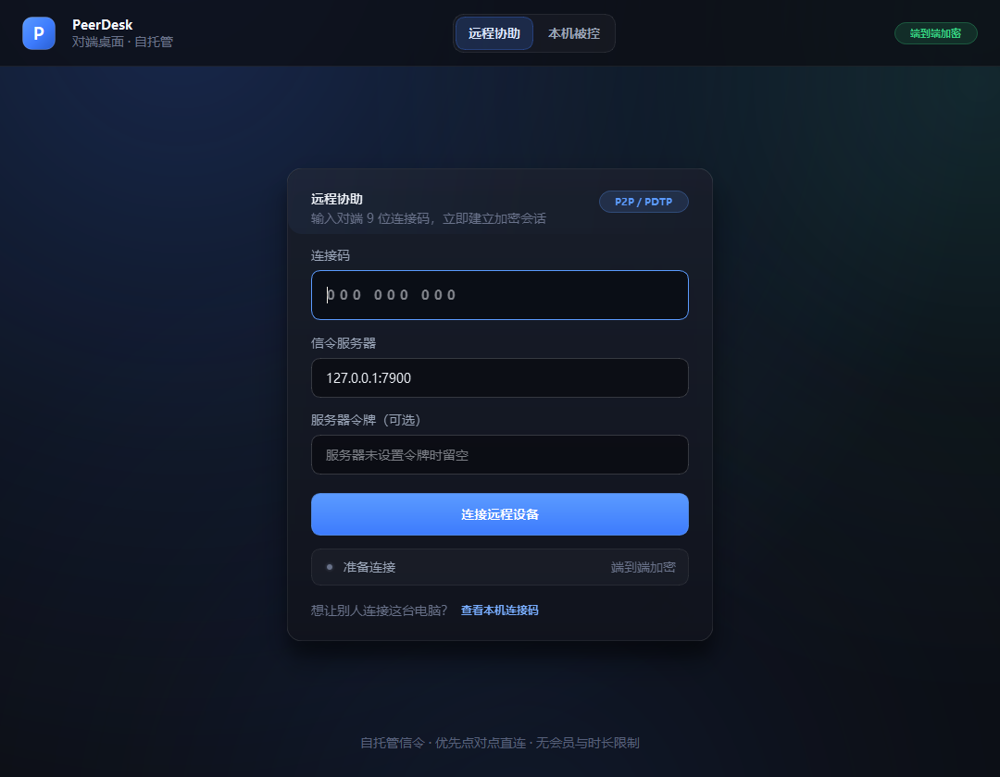
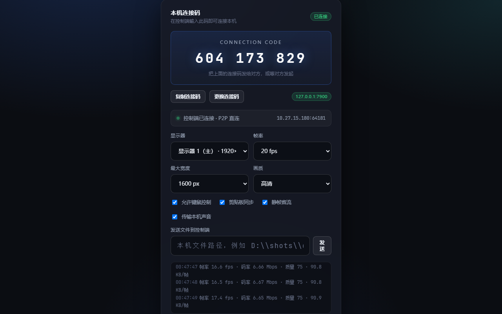

# UI 复刻对照

目标不是像素级抄一份，而是把 **UU远程 的交互语言** 搬到一个不依赖它运行时的实现上：
9 位连接码作为唯一入场券、深色玻璃面板、会话内悬浮工具栏、状态一眼可见。

> 说明：UU远程 的业务界面由 WebView2 下发（`bin/html` 只有骨架页），所以"UU 侧表现"一栏
> 部分来自本机可观测到的配置/字符串与运行行为，标注为「观测」；其余标注「推断」。

## 0. 原生 Qt 客户端（0.7 迁移中）

前端目标形态是 **Qt 6 Widgets 原生窗口**。本阶段已经落地连接页、被控端页和统一窗口壳，
不再需要浏览器或本地 HTTP 桥：

| 区域 | 已实现 | 尚未实现 |
| --- | --- | --- |
| 应用壳 | 深色渐变舞台、玻璃卡片、品牌头、远程协助/本机被控导航、端到端加密标识、toast | 托盘、设置页、窗口位置持久化 |
| 连接页 | 9 位连接码 3-3-3 自动分组、服务器/令牌输入、非法输入就地提示、连接中/已连接状态、会话中断开 | 收藏设备、二维码、最近连接 |
| 被控端页 | 大字连接码/复制/更换、显示器/帧率/宽度/画质、键鼠/剪贴板/静帧/声音开关、发文件、拖放文件、日志 | 更强的会话确认与权限提示 |
| 会话页 | 控制器已能解码并发出 `QImage` 帧信号 | 视频画布、HUD、自动隐藏悬浮工具栏、键鼠捕获、全屏、拖放上传 |

当前可运行入口是 `peerdesk-client`。远程会话的 **Viewer 视频页还没有接入这个 Qt 壳**，
所以不能把本阶段的截图当作完整会话体验；下一阶段会先补画布与 HUD，再接输入捕获和悬浮工具栏。

> `peerdesk-client.exe --capture test --page remote --screenshot docs\screenshot-native-connect.png`
>
> 截图使用临时配置，不读取真实服务器、桌面或系统声音。

> `peerdesk-client.exe --capture test --page host --screenshot docs\screenshot-native-host.png`
>
> 被控端页展示合成屏幕源下的完整布局；截图模式关闭了自动启动，避免误开真实会话。

## 1. 界面清单

| # | 界面 | UU远程 侧 | PeerDesk 实现 | 差异 |
| --- | --- | --- | --- | --- |
| 1 | 入场/连接码页 | 大字设备码 + 复制/更换，3-3-3 分组（观测：`saved_device_code_*.ini` 存 9 位、`-c/--reset-custom-code` 可改码） | `viewer.html#gate`：`连接码` 输入（自动分组）+ `信令服务器` + 主按钮 | 无账号体系；服务器地址手填（自托管） |
| 2 | 被控端面板 | `setting_<devid>.ini` 存窗口几何/画质/`smart_mouse`（观测） | `agent.html`：大字连接码 + 复制/更换 + 显示器/帧率/宽度/画质 + 允许键鼠/剪贴板/静帧/声音 开关 + 日志 | UU 把设置藏进二级菜单，PeerDesk 平铺 |
| 3 | 会话工具栏 | 悬浮胶囊，含画质/显示器/键鼠/剪贴板/全屏/断开（推断自会话页与配置项） | `viewer.html#toolbar`：显示器 1 / 均衡 / 剪贴板 / 键盘 / CAD / 声音 / 全屏 / HUD / 断开 | 增加 HUD 开关（自用诊断）与声音开关（UU 的"传输声音"在二级菜单里） |
| 4 | 画质档位 | `quality=2`、`auto_quality=3`（观测） | `流畅/均衡/高清/超清/原生` 五档 → fps+width+quality 组合 | 语义化命名，档位映射见 `viewer.js` |
| 5 | 状态提示 | 连接中/已连接/中继（推断） | 页脚 toast：`已连接 · P2P 直连`、`已连接 · 中继模式`、`正在打洞…` | 直连/中继用不同文案与颜色 |
| 6 | HUD | 会员权益/码率浮层（推断） | 右上角：链路/P2P 或 中继/分辨率/帧率/码率/延迟/声音 | 免费、常显 |
| 7 | 会员/充值 | 充值页 + `member/entitlements` + `consumption-record`（观测） | **不存在** | 核心差异：不打会员，不卖中继 |

## 2. 视觉规范（Qt `src/ui/ui_theme.cpp`，数值沿用 Web 参考版）

| Token | 值 | 用途 |
| --- | --- | --- |
| `--bg-0` | `#0b0d12` | 舞台底色（canvas 黑边同色） |
| `--bg-1` / `--bg-2` | `#12151d` / `#171b26` | 卡片层次 |
| `--panel` | `rgba(23,27,38,.86)` | 玻璃拟态面板 + `backdrop-filter: blur()` |
| `--blue` / `--blue-2` | `#3d7bfd` / `#5b9bff` | 主按钮、焦点环、强调 |
| `--cyan` | `#43d9e8` | 渐变副色（背景光晕） |
| `--green` / `--amber` / `--red` | `#35d07f` / `#f4b740` / `#f2555a` | 直连 / 打洞中 / 断开 |
| `--radius` | `16px` | 卡片圆角（按钮 10px） |
| 字体 | PingFang SC → 微软雅黑 UI → Segoe UI | 中文优先栈 |
| 等宽 | JetBrains Mono → Cascadia → Consolas | 连接码、HUD 数字 |

背景是三层径向渐变光晕叠在深海军蓝上（`body` 的 `radial-gradient`），
没有图片资源——整个 UI 只有 3 个文件（`viewer.html`/`agent.html`/`style.css` + 2 个 js），
不依赖任何前端框架与构建步骤。

## 3. 交互细节

- **连接码输入**：输入即自动 3-3-3 分组（`fmtCode`），回车直接连接；非法长度不发请求，
  只在状态行提示（不弹窗）。
- **工具栏自动隐藏**：鼠标静止 3 秒后淡出，移动即出现；`HUD` 独立开关。
- **声音开关**：工具栏 `声音` 按钮（`.tool.active` 高亮即开启）+ HUD `声音` 行显示 `开/关/静音/NN 帧/s`，
  状态写进 `localStorage.pd.audio`，刷新后保持；点一下同时通知被控端起停采集（省带宽，不只是本地静音）。
- **服务器令牌**：连接码页新增可选输入框（`#token`，占位符"服务器令牌（没设就留空）"），
  值记在 `localStorage.pd.token`；`ready` 收到 `token_required` 且输入框为空时状态行提示
  "该服务器需要令牌"（不弹窗、不阻断，等用户自己决定）。错误 `bad_token` / `rate_limited`
  映射成中文提示落在同一状态行。
- **带宽上限提示**：`stats` 带 `cap` 时，HUD 码率行显示 `6.5 Mbps / 限 1.5`；
  帧率因节流被压低时显示 `4 fps (限 4)`，让人一眼看出"慢不是网络卡，而是服务器在上限"。
- **键盘捕获**：点画布进入"键盘直通"模式，`e.code` 原样转发（含 `F1–F24`、方向键、
  小键盘、修饰键），`Ctrl+Alt+Del` 单独走按钮（浏览器不允许脚本触发）。
- **鼠标**：`mousemove` 经 `requestAnimationFrame` 合并，最多每帧一条；滚轮按 120 的倍数归并。
- **画质切换**：改档位即发 `{t:"quality", v}`，被控端立刻 `settings` 更新并强制关键帧。
- **断线语义**：WS 断开（本地桥）→ "刷新页面重试"；PDTP 断开 → "连接已断开" + 工具栏隐藏。

## 4. Web 参考截图

以下截图来自迁移前的浏览器前端，保留用于对照交互细节；原生 Qt 截图见第 0 节。

> 截图里的画面来自 `--capture test` 的合成信号源（渐变底 + 网格 + 时钟 + 移动方块），
> 不读真实屏幕，可安全提交到仓库。重截命令见 `docs/06-handover.md`。

> 本机回环自测：server + agent + viewer 三进程都在一台机器上。
> 右上角 HUD：`P2P / 1600×900 @ 1280×800 / 16.8 fps / 6.66 Mbps / 0.5 ms / 声音 静音`。
> 帧率行只有在服务器下发了 `--relay-mbps` 上限、且被控端据此降帧时才会附加 `(限 N)`。

> 被控端面板：连接码、链路状态、显示器/帧率/最大宽度/画质、四个开关
> （允许键鼠控制 / 剪贴板同步 / 静帧省流 / 传输本机声音）、发文件、事件日志。
> 帧率与最大宽度下拉会自动补上 CLI 传来的非标准值（例如 `--fps 20`），不会显示成空白。

> 控制端首屏：9 位连接码、信令服务器、服务器令牌（可留空）。
